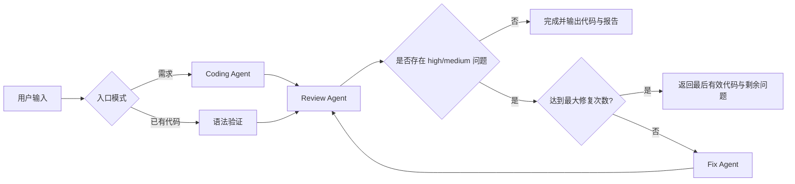

# ReviewFlow 多 Agent 代码审查工作流

ReviewFlow 是一个用于软件工程课程 Homework 2 的轻量多 Agent Workflow。用户可以从自然语言需求或已有 Python 代码开始，让 Coding、Review、Fix 三个角色 Agent 通过共享状态、结构化消息和条件分支完成“编码/接收代码 → 审查 → 修复 → 复审”的闭环。

项目坚持只做静态分析：**不会执行用户提交或 Agent 生成的代码**。

## Workflow



编排器是普通 Python 类，不依赖 LangGraph、CrewAI 或 AutoGen。节点返回统一的 `NodeOutput`，由编排器写入 `WorkflowState` 并决定下一步，因此新增 Agent 不需要修改现有 Agent 的内部实现。

## 功能

- 两种入口：自然语言需求生成代码，或提交已有 `.py` 代码。
- 三个职责隔离的 Agent：`CodingAgent`、`ReviewAgent`、`FixAgent`。
- 共享状态与显式消息传递：每次运行保存代码、审查历史、修复历史、消息和事件。
- 顺序执行、条件分支和有限循环：默认最多修复 2 次，可配置 0～3 次。
- 审查能力复用 Homework 1：AST、Ruff、Mypy、LLM 综合分析与工具结果降级。
- 结构化输出修复：Agent 返回无效 JSON 时自动要求修复一次。
- Python 语法门禁：编码和修复结果必须可被 `ast.parse` 解析。
- Streamlit 展示：执行时间线、共享状态、问题列表、修复差异和 Markdown/JSON 导出。
- 错误处理：LLM 超时/重试、工具单项失败、缺失 API Key、无效输入和最大循环终止。

## 快速开始

### 1. 准备 Python 和依赖

```powershell
.\setup.ps1
```

脚本使用 `uv` 安装 Python 3.12 并同步依赖。

### 2. 配置 DeepSeek

复制 `.env.example` 为 `.env`，填写：

```dotenv
DEEPSEEK_API_KEY=你的完整密钥
```

`.env` 已被 `.gitignore` 排除。需求模式、LLM 综合审查和修复功能需要有效 Key；已有代码在没有 Key 时仍可展示静态工具降级结果。

### 3. 启动网页

```powershell
.\run.ps1
```

默认访问 `http://localhost:8501`。

## 使用流程

1. 在侧边栏选择流程入口、修复阈值和最大修复次数。
2. 需求模式填写需求描述；已有代码模式粘贴代码或上传 UTF-8 `.py` 文件。
3. 选择是否启用 Ruff、Mypy 和严格审查模式。
4. 点击“开始执行 Workflow”。
5. 查看 Agent 时间线、共享状态、审查问题、修复记录和代码差异。
6. 下载完整 Markdown 报告或 JSON 运行记录。

## 关键配置

| 环境变量 | 默认值 | 说明 |
|---|---|---|
| `DEEPSEEK_API_KEY` | 空 | DeepSeek API 密钥 |
| `DEEPSEEK_BASE_URL` | `https://api.deepseek.com` | OpenAI 兼容接口地址 |
| `DEEPSEEK_MODEL` | `deepseek-chat` | 模型名称 |
| `LLM_TEMPERATURE` | `0.2` | 模型温度 |
| `LLM_TIMEOUT_SECONDS` | `60` | 单次请求超时 |
| `LLM_MAX_RETRIES` | `3` | LLM 调用最大尝试次数 |
| `MAX_CODE_CHARS` | `20000` | 单文件最大字符数 |
| `TOOL_TIMEOUT_SECONDS` | `15` | Ruff/Mypy 单项超时 |

## Agent 与共享状态

| 节点 | 输入 | 输出 |
|---|---|---|
| Coding Agent | 自然语言需求 | `CodeArtifact` |
| Review Agent | 当前代码、可选需求、静态工具结果 | `ReviewArtifact` |
| Fix Agent | 当前代码、阻断问题、历史修复记录 | `FixArtifact` |

`WorkflowState` 是唯一共享上下文，保存：

- `current_code`：当前有效代码；
- `code_artifact`：编码结果；
- `review_history`：各轮审查；
- `fix_history`：各次修复；
- `messages`：Agent 间结构化消息；
- `events`：面向用户和测试的执行时间线；
- `repair_attempts`、`status` 和 `failure_reason`。

## 项目结构

```text
app.py                              Streamlit 入口
src/reviewflow/orchestrator.py      轻量编排器
src/reviewflow/agents/              Coding、Review、Fix Agent
src/reviewflow/static_review.py     Homework 1 审查逻辑重构版
src/reviewflow/tools/               AST、Ruff、Mypy 工具
src/reviewflow/models.py            状态、消息和工件模型
src/reviewflow/services/            报告与差异生成
tests/                              自动化测试
samples/                            演示输入
```

## 测试

```powershell
.\test.ps1
```

测试使用脚本化 Fake LLM 和 Fake 节点，不消耗真实 API。覆盖初始审查通过、失败后修复通过、达到最大修复次数、已有代码跳过编码、无效 JSON、语法错误、缺失 Key 和阈值判断。

## 安全与限制

- 不执行任何用户代码或 Agent 生成代码。
- 只支持单个 UTF-8 Python 文件。
- LLM 可能误报或漏报；工具直接发现的问题优先保留。
- 审查结果依赖当前模型和静态工具版本，不代表运行时正确性。
- 运行状态保存在当前 Streamlit 会话，不跨重启持久化。
- 修复 Agent 返回完整文件，不直接覆盖磁盘上的原文件。
